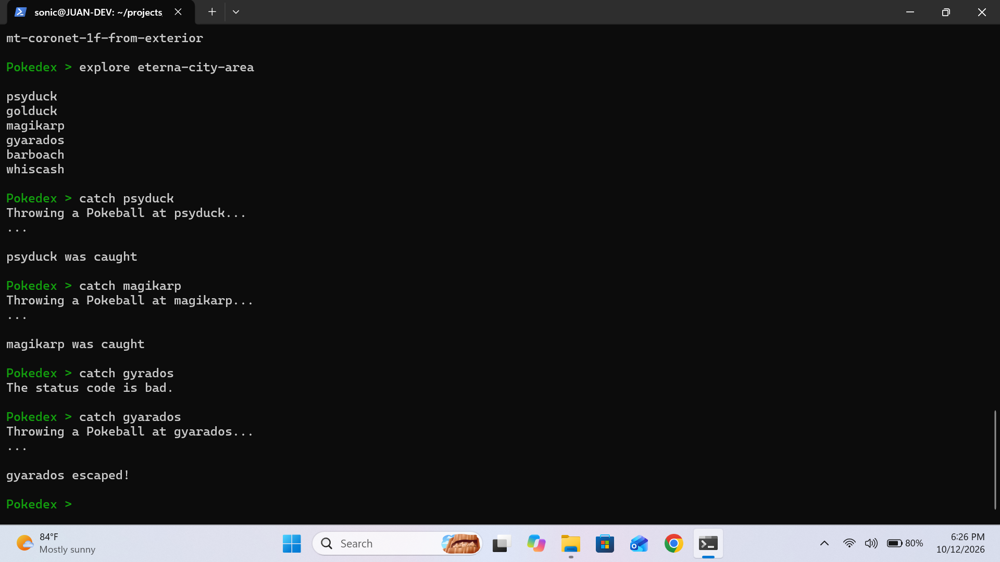
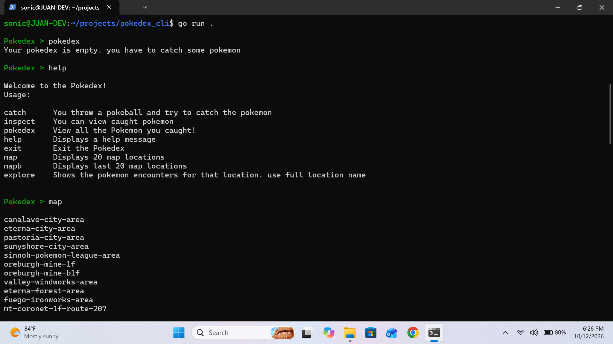
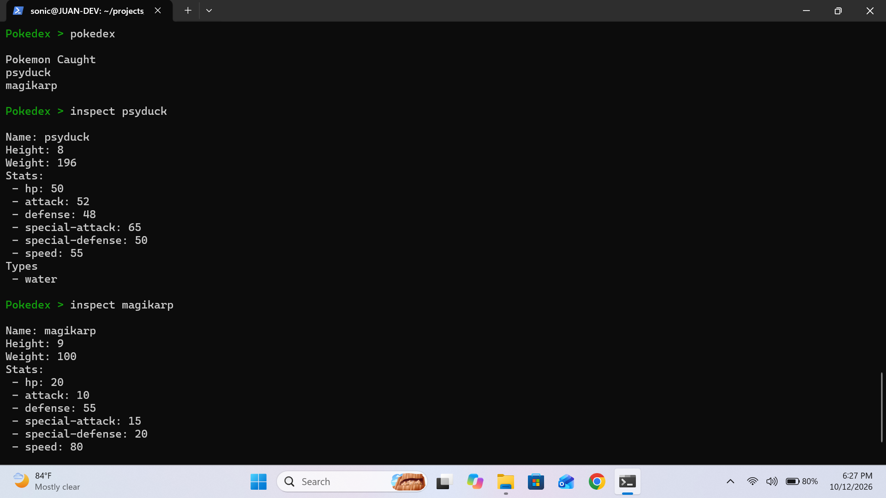

# Pokédex CLI

## Overview
Pokédex is a command-line application written in Go that allows users to explore different locations and discover which Pokémon can be encountered in each area.

Users can attempt to catch Pokémon and add them to their personal Pokédex. The current version provides unlimited Poké Balls, but catching Pokémon isn't guaranteed. Pokémon with higher base experience are more difficult to catch.

## Features
- Browse Pokémon locations with forward and backward pagination.
- Explore locations to discover Pokémon encounters.
- Attempt to catch Pokémon with varying success rates.
- Store caught Pokémon in a personal Pokédex.
- Inspect caught Pokémon to view their stats and types.
- Cache API responses to reduce unnecessary requests.

## Screenshots

### Exploring and Catching Pokémon


### Available Commands


### Inspecting Pokémon



## Prerequisites

Before running Pokédex CLI, make sure you have:

- [Go](https://go.dev/doc/install)
- [Git](https://git-scm.com/install/)

## Installation

Clone the repository:

```bash
git clone https://github.com/JtorresBear/pokedex_cli.git
```

Navigate into the project directory:

```bash
cd pokedex_cli
```

Run the application:

```bash
go run .
```


## Commands

| Command | Purpose |
|---|---|
| `map` | Display the next 20 locations |
| `mapb` | Display the previous 20 locations |
| `explore <location>` | See Pokémon in a location |
| `catch <pokemon>` | Attempt to catch a Pokémon |
| `inspect <pokemon>` | View a caught Pokémon's details |
| `pokedex` | List caught Pokémon |
| `help` | Display available commands |
| `exit` | Close the application |


## Technical Details
**API Communication:** The application sends HTTP requests to PokéAPI to retrieve information about Pokémon and their locations. If a request fails, the application displays an error message to inform the user.

**Caching:** Pokédex temporarily stores previously requested data to avoid making unnecessary HTTP requests. Cached data currently expires after 5 seconds, but this duration can be adjusted in `main.go` to retain information longer.

**Concurrency:** Since the cache can be read from and written to, I used a mutex to prevent multiple goroutines from accessing and modifying the cache simultaneously, avoiding potential race conditions.

**Data Handling:** The information received from HTTP requests is formatted as JSON. I used Go's `encoding/json` package to unmarshal the data into structs, making it easier to access and display the information to the user.


## Skills Practiced

- **Go Programming:** Strengthened my understanding of structs, maps, functions, and packages.
- **HTTP & APIs:** Practiced making HTTP requests and handling responses from an external API.
- **JSON:** Worked with unmarshalling JSON data into Go structs.
- **Caching:** Implemented an in-memory cache to reduce unnecessary API requests.
- **Concurrency:** Used mutexes to protect shared data from race conditions.
- **Error Handling:** Practiced handling errors and unexpected user input.
- **Code Organization:** Separated functionality into packages and individual command handlers.

## Usage 

Pokedex > map
Pokedex > explore canalave-city-area
Pokedex > catch pikachu
Pokedex > pokedex
Pokedex > inspect pikachu